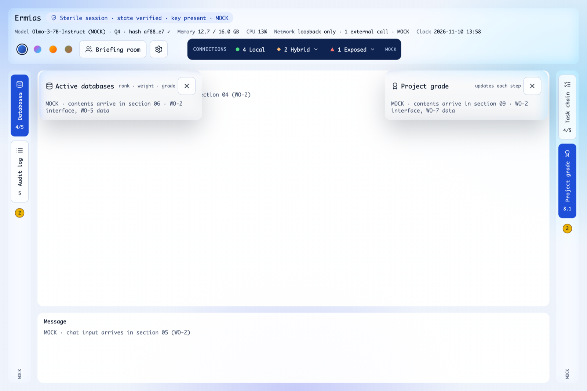
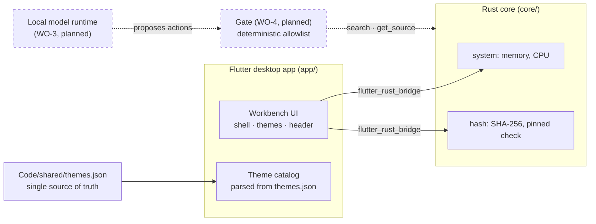
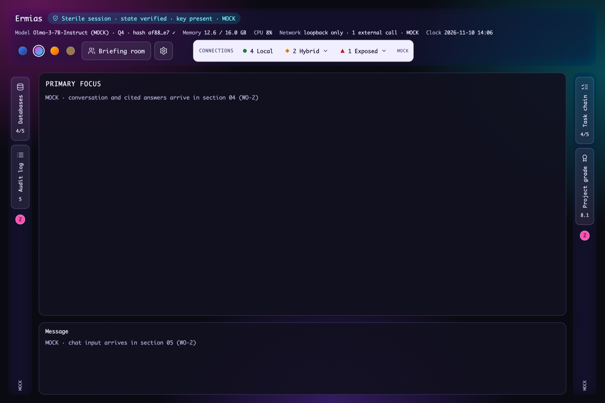
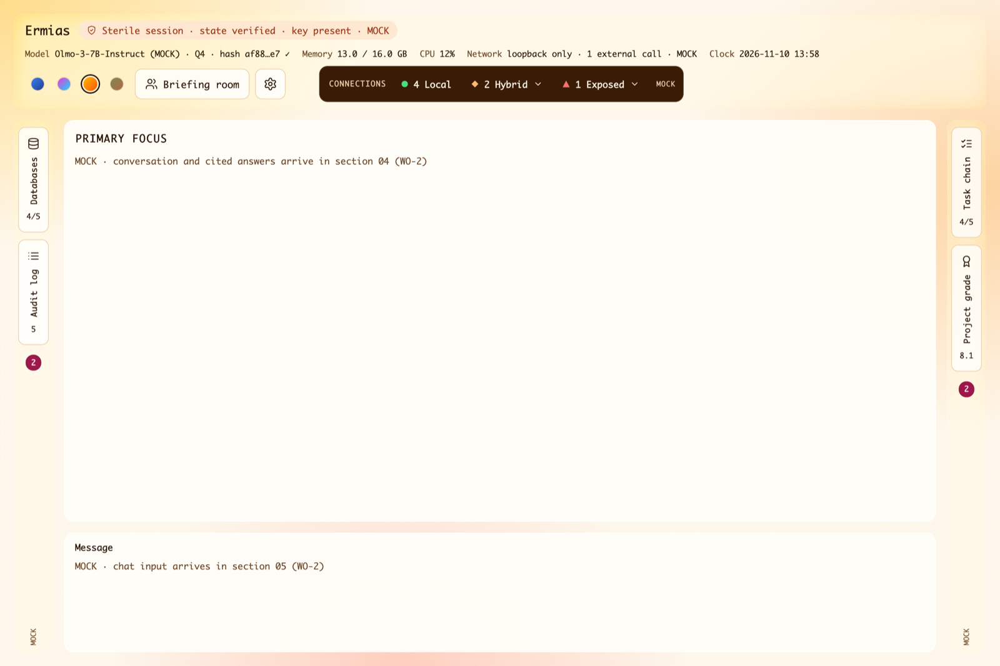
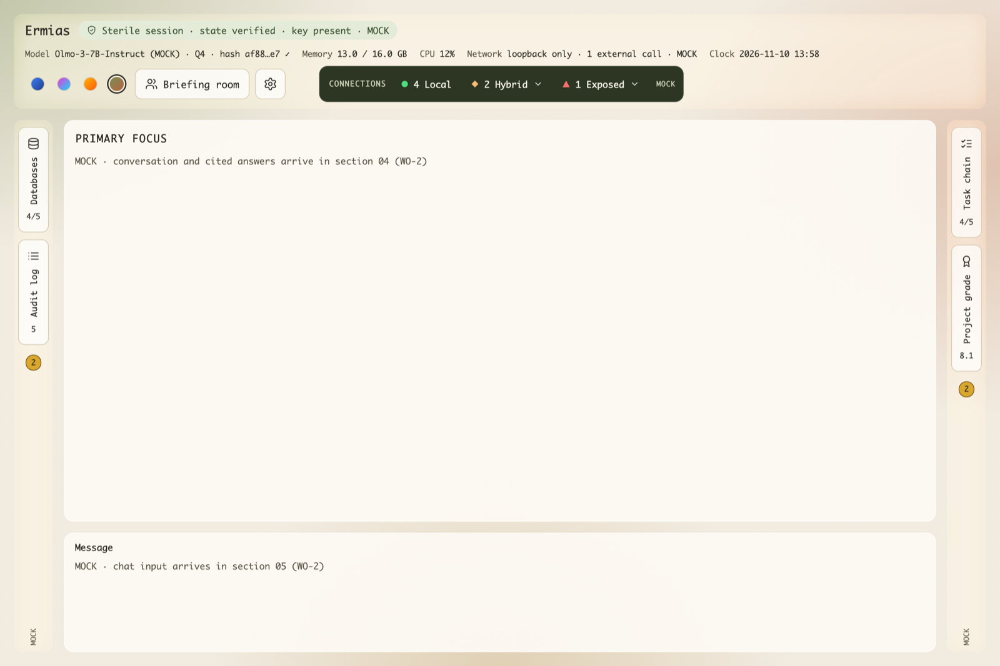
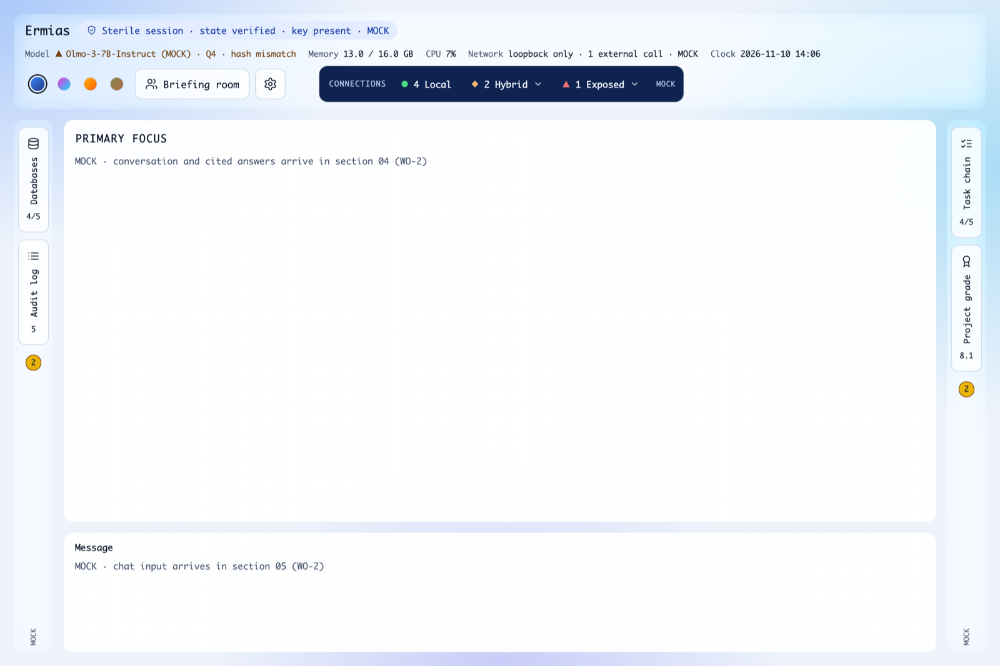

# Ermias

**Your work, your way.** Ermias is a local-first research workbench. You set the goal, rank your sources and approve every step; a language model running on your own machine does the processing, and every answer is traced back to the source it came from.

**Why:** research tools that send documents and prompts to a cloud model ask you to give up three things: your data, your compute, and the final say. Ermias keeps all three with the person. Local models and local files are the default. A small deterministic program, the *gate*, with no model inside it, decides what the model may touch. Anything that leaves the machine is visible, approved and logged.



## Status

Build 1.0 is delivered in work orders, each closed by a smoke test on the real app. Values not built yet are labeled **MOCK** in the interface and in the code.

| Work order | Scope | Status |
|---|---|---|
| **WO-1** | Workbench shell, four themes, header with live system readings and model hash check | **Done** · [plan, drift flags, smoke results](docs/work-orders/WO-1.md) |
| WO-2 | Panels 03–09 on mock data (connections windows, PRIMARY FOCUS, chat, databases, audit log, task chain, grade) | Planned |
| WO-3 | Sign-in, project kickoff, Settings: model providers | Planned |
| WO-4 | The gate: deterministic allowlist between the model and everything it can touch | Planned |
| WO-5 | Local folders as ranked source databases | Planned |
| WO-6 | Connections monitor (beta) | Planned |
| WO-7 | Grading against benchmarks agreed at kickoff | Planned |

**What runs today (macOS):** the full workbench frame with keyboard-accessible edge strips and overlay panels; all four themes switchable live; memory and CPU read from a Rust core every 2 seconds; a SHA-256 integrity check of the model file that fails closed (a changed or missing file is a warning and is logged as needing a human). The model, session, connections and panel contents are MOCK.

## Reviewer guide

| To see | Go to |
|---|---|
| How it is built and why | [docs/ARCHITECTURE.md](docs/ARCHITECTURE.md) |
| Every decision, and whether the owner or Claude made it | [DECISION_LOG.md](DECISION_LOG.md) |
| Locked design decisions and their change history | [DESIGN_DECISIONS.md](DESIGN_DECISIONS.md) |
| WO-1: plan, drift flags, smoke-test results | [docs/work-orders/WO-1.md](docs/work-orders/WO-1.md) |
| Every dependency, pinned, with its reason | [DEPENDENCIES.md](DEPENDENCIES.md) |
| Questions waiting on the owner | [OPEN_QUESTIONS.md](OPEN_QUESTIONS.md) |
| Section specs with acceptance tests | [Code/build-1.0-local-app/](Code/build-1.0-local-app/) |
| Approved visual design | [Code/reference/](Code/reference/) |
| Data contracts (JSON Schema) | [Code/shared/contracts/](Code/shared/contracts/) |
| Tests: unit and widget · Rust · smoke | [app/test/](app/test/) · [core/src/api/](core/src/api/) · [app/integration_test/](app/integration_test/) |
| Screenshots from the latest smoke run | [docs/screenshots/](docs/screenshots/) |

## Architecture



- **Flutter (Dart) for the interface, Rust for everything that touches the operating system.** The Rust core is compiled during the Flutter build through native-assets build hooks, using the toolchain pinned in `core/rust-toolchain.toml`.
- **One source of truth for color.** `Code/shared/themes.json` is parsed at runtime; a test fails if the app's copy differs from it by a single byte, and the spec's contrast rules run as tests for every theme.
- **Immutable UI state behind small interfaces.** Every mock implements the same interface its real replacement will, so later work orders swap data sources without touching the interface.

Details: [docs/ARCHITECTURE.md](docs/ARCHITECTURE.md).

## Security model

Enforced today:
- **No network in shipped builds.** The macOS release build runs in the App Sandbox with no network entitlement, so the operating system refuses connections. There is no telemetry, analytics, crash reporting or update check.
- **Nothing fetched at runtime.** Icons are drawn from bundled path data; the font (Monaco) comes from the operating system.
- **Fail closed on integrity.** A model file that does not match its pinned SHA-256, or cannot be read, is never shown as verified.
- **Pinned dependencies.** Every package and crate is pinned to an exact version and justified in [DEPENDENCIES.md](DEPENDENCIES.md).

Planned, specified in `Code/build-1.0-local-app/`: the gate (11), local password sign-in with encrypted API keys (12), a tamper-evident audit log (07, open question 9), and the connections monitor (03).

## Build and test

Requirements: macOS with Xcode, Flutter 3.47.5, and [rustup](https://rustup.rs) with `~/.cargo/bin` on `PATH`. Rust 1.98.1 is selected automatically by `core/rust-toolchain.toml`.

```sh
cd app
flutter test                            # 101 unit and widget tests
flutter test integration_test -d macos  # smoke test on the real app; writes screenshots
flutter run -d macos                    # run the app

cd ../core
cargo test                              # 8 Rust tests
cargo clippy --all-targets -- -D warnings
```

To regenerate the Dart bindings after changing `core/src/api`: `cargo install flutter_rust_bridge_codegen@2.13.0 --locked`, then `flutter_rust_bridge_codegen generate` in `app/`.

## How the work is run

- **Spec first.** Each section in `Code/build-1.0-local-app/` lists what is locked, its acceptance tests, and when to escalate to the owner.
- **Tests first.** Acceptance tests from the spec are written as automated tests before the code.
- **Reviewed.** Each section is code-reviewed before its pull request; findings are fixed or rejected with a reason in the decision log.
- **Drift is flagged, not absorbed.** Any gap between spec and code, or inside the spec, is recorded in the work order with its resolution.

## Screens in Build 1.0
1. **Sign in and projects** (`12_sign_in`): username and password, then Review / Resume / Research.
2. **Project kickoff** (`10_project_kickoff`): goal, deliverable, sources, benchmarks, confirm.
3. **Workbench** (`00`–`09`, `11`): header, edge tool strips, PRIMARY FOCUS, chat.
4. **Settings: model providers** (`13_settings`): local runtimes and cloud API keys.

| | |
|---|---|
|  |  |
| Cyberpunk | Sunburst |
|  |  |
| Earth tones | Model file changed: the hash check fails and is logged |

## Build order
1. Interface on clearly labeled mock data, built so each mock can be replaced without changing the interface.
2. The gate (`11_gate`).
3. Local folders as the source databases (`06_databases`). A full database engine is Build 2.0.
4. Connections monitor (`03_connections`), released as beta.
5. Grading (`09_project_grade` with `10_project_kickoff`). A core function, not an add-on.

## Repository map

```
app/                 Flutter desktop app (lib/, test/, integration_test/)
core/                Rust core: system readings and file hashing
Code/                Build 1.0 specification
  shared/            themes.json (single source of truth) and data contracts
  build-1.0-local-app/  one folder per section: spec + reference code
  build-2.0-pwa/     deferred scope
  reference/         approved design source, screenshots and logo
docs/                Architecture, work orders, screenshots
DECISION_LOG.md      Every decision, by HUMAN or CLAUDE
DESIGN_DECISIONS.md  Locked design decisions
DEPENDENCIES.md      Pinned dependencies and why
OPEN_QUESTIONS.md    Undecided items; ask the owner, do not guess
CLAUDE.md            Operating rules for Claude Code (read first)
```

## License

MIT. See [LICENSE](LICENSE).
