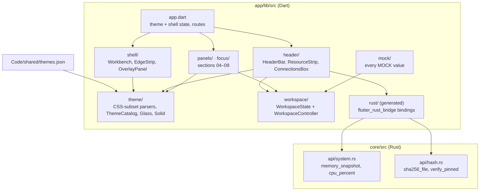

# Architecture

Ermias is a desktop app in two parts: a Flutter interface (`app/`) and a Rust core (`core/`). The specification it implements lives in `Code/`. This page describes what exists after WO-2 and where later work orders attach.

## Layers

| Layer | Responsibility | Spec section |
|---|---|---|
| `theme/` | Parse `themes.json` (hex, `rgba()`, radial glow layers, swatch gradients, `box-shadow`) into typed `ErmiasTheme`s; glass and solid surfaces; type scale. Rejects anything outside the CSS subset. | 01 |
| `shell/` | Workbench frame: edge strips, tabs, overlay panels, center placeholder. `ShellState` is immutable; widgets emit `ShellUpdate` functions. | 00 |
| `header/` | Two-row header: session, live resources, model hash check, theme switch, Settings, connections box. `ResourceSource` is the seam to the Rust core. | 02 (03 box) |
| `workspace/` | One immutable `WorkspaceState` shaped like the data contracts. `WorkspaceController` applies every action as a new state, logs what the spec says is logged, derives strip figures, drift flags and the network summary, and holds external calls until approved. It is also the app's `AuditSink`. | 03–09 |
| `panels/`, `focus/` | Databases, audit log (+ full log), task chain, grade; PRIMARY FOCUS with source chips; chat input with model/tools selects and the approval prompt. | 04–09 |
| `audit/` | `AuditSink` interface and `AuditEntry`. The log is in memory (MOCK); persistence and tamper evidence are section 07 + open question 9. | 07 |
| `core/` | All operating-system work. No function opens a network connection. Errors are returned to Dart, never hidden. | 02 |

## Key decisions

| Decision | Why | Ref |
|---|---|---|
| Flutter UI + Rust core, no Python | Fewest runtimes; one memory-safe core for system and security work. | D-001 |
| Rust built by Flutter native assets, toolchain pinned in `core/rust-toolchain.toml` | No CocoaPods or vendored build tool; reproducible builds. | D-036, D-039 |
| `themes.json` stays the single source; the app parses its CSS strings | No second color format to drift; byte-identity test guards the bundled copy. | D-023 |
| Immutable state + update functions | Two inputs in one frame cannot overwrite each other (found by a test). | D-032 |
| Every mock behind the interface its real source will implement | Later work orders swap sources without touching widgets. | `CLAUDE.md` |
| One workspace controller for all panels | Every logged action lands in one audit log; figures cannot disagree with the panels they summarise. | WO-2 |
| Model integrity fails closed | A missing or unreadable model file is a warning, never a pass. | D-043 |
| Icons drawn from the reference SVG path data by an in-house parser | No SVG dependency; only approved icons exist. | D-033 |

## Testing

| Level | Where | What it proves |
|---|---|---|
| Unit | `app/test/theme`, `app/test/icons`, `app/test/shell/shell_state_test.dart`, `core/src/api/*` | Parsers reject bad input; contrast rules hold for every theme; shell rules; hashing and readings. |
| Widget | `app/test/shell`, `app/test/header`, `app/test/app_test.dart` | The 00, 01 and 02 acceptance tests, including keyboard access, semantics and layout at the reference and minimum sizes. |
| Smoke | `app/integration_test/smoke_test.dart` | The real app on macOS with the real Rust core; writes `docs/screenshots/`. |

## Where later work attaches

- **WO-3** replaces `mockModel`, the session pill and `SettingsPlaceholder` with sign-in, kickoff and model providers.
- **WO-4** adds the gate between the model and `core/`, as a separate deterministic module with its allowlist in a file the model cannot write.
- **WO-5/6/7** replace the MOCK seed in `mock/mock_workspace.dart` (databases, connections, grade) with local folders, the connections monitor and grading; the controller's intents stay the same.
